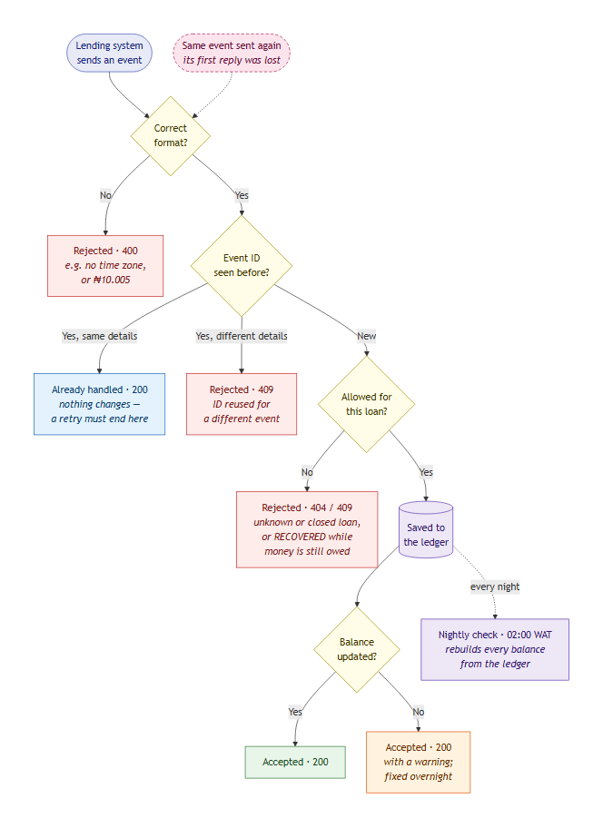

# RecoveryLedger — business rules

RecoveryLedger is a **fictional** loan-recovery system built for this assessment. It is not a description of any real product. Lending systems ("clients") send it events about loans in default; it keeps the outstanding balance of every defaulted loan.

## Flow map

What happens to one event (escalation, repayment, interest or resolution) from the moment a lending system sends it. Follow it from the top; each diamond is a yes/no question.

Chart source: [diagrams/flow-map.mmd](diagrams/flow-map.mmd). After editing it, regenerate the image with `npx tsx scripts/render-diagram.ts`.

**Colour key:** red = rejected, green = accepted, orange = accepted with a warning, blue = recognised as a repeat, pink dashed = a retry.

**Where the bug is:** start from the pink box. When a reply is lost, the lending system sends the same event again. That resend must end at the blue **"Already handled"** box. In the faulty build it is wrongly treated as **New** and saved a second time, so a ₦6,000 repayment counts as ₦12,000.

## Basics

| ID | Rule |
|---|---|
| B1 | All amounts are naira with at most 2 decimal places (whole kobo; ₦1.00 = 100 kobo). An amount with a fraction of a kobo (e.g. ₦10.005) is rejected. Balances are computed in integer kobo internally so arithmetic is exact. |
| B2 | `event_time` is ISO 8601 with an explicit zone (`Z` or `±hh:mm`). Zone-less timestamps are rejected. |
| B3 | The business day is the WAT calendar day (UTC+1, no daylight saving): 00:00:00–23:59:59.999 WAT. 23:00:00Z belongs to the next WAT day. |
| B4 | Every event carries `client_id`, `event_id`, `loan_id`, `type`, `event_time`, and `sent_at` (the client's timestamp for this send attempt — it changes on every retry). |
| B5 | **Duplicate rule.** `client_id` + `event_id` identifies an event. A repeat with the same business data is acknowledged `200 DUPLICATE` and changes nothing. A repeat with different business data is rejected `409 EVENT_ID_CONFLICT`. `sent_at` is transport metadata and is never part of the identity. |
| B6 | Two different `event_id`s with the same amount are two real events and both apply. |

## Events

| ID | Event | Rule |
|---|---|---|
| E1 | Escalation | Opens a record with principal and interest outstanding; status `IN_RECOVERY`. A second escalation for a loan already in recovery → `409 LOAN_ALREADY_IN_RECOVERY`. A resolved loan cannot be re-escalated → `409 LOAN_RESOLVED`. |
| R1 | Repayment | Applied to interest first, then principal. |
| R2 | Repayment | If it exceeds the balance, the balance stops at 0 and the excess is recorded as `overpayment_naira`. |
| R3 | Repayment | Unknown loan → `404 LOAN_NOT_FOUND`. Resolved loan → `409 LOAN_RESOLVED`. |
| I1 | Interest | Adds to interest outstanding. Rejected on a resolved loan. |
| S1 | Resolution `RECOVERED` | Accepted only when total outstanding is 0, else `409 BALANCE_NOT_ZERO`. |
| S2 | Resolution `WRITTEN_OFF` | Accepted with a balance above 0; the balance is kept as `written_off_naira`. |
| S3 | After resolution | A resolved loan accepts no further events. |

## Processing and failure

| ID | Rule |
|---|---|
| P1 | The **event ledger is the source of truth**. The stored balance is a projection of it. |
| P2 | The client receives success only after the event is committed to the ledger. |
| P3 | If the balance update fails after commit, the event is **not** rolled back. The response carries `warning: BALANCE_UPDATE_PENDING` and the next reconciliation repairs the balance. |
| P4 | Clients retry on timeout or 5xx with the **same `event_id`** (assumed client retry policy). |

## Daily reconciliation

| ID | Rule |
|---|---|
| D1 | Runs daily at 02:00 WAT for the previous WAT business day (triggered manually in this fixture via `POST /jobs/reconcile`). |
| D2 | Replays the ledger to recompute every balance, compares with the stored balance, corrects mismatches and lists them in `mismatches_corrected` for ops review. |
| D3 | Reports the business day's repayment count, total and event IDs. |

## Assumptions about accounts and admin settings

- A `loan_id` is unique within a client. Loans never move between clients, and `client_id` is fixed per lending system.
- No admin setting can pause recovery or change the allocation order mid-cycle in this version. If one is added, it needs its own rules and tests.
- Borrower account changes (for example a new repayment account) don't affect RecoveryLedger, which only receives events.
- The reconciliation schedule (02:00 WAT) is configuration; changing it must not change which events count for a business day (B3).
